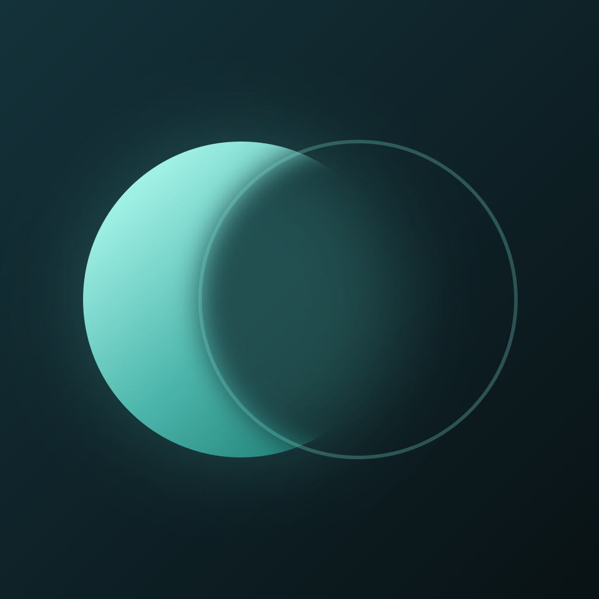

# Penumbra

Non-destructive photo editor with 36 tools, from curves and lens blur to film looks. Opens JPEG, PNG, TIFF and DNG/RAW, and edits stay reversible until you export. Runs on Android, iOS, web, Windows, macOS and Linux.

## Run

    flutter create --project-name penumbra .   # or: bash tools/setup_platforms.sh
    flutter pub get
    flutter run

`tools/setup_platforms.sh [platforms]` creates the platform folders and applies the native patches (Android minSdk 24 and storage permission, iOS 15.5 and photo/camera usage strings, macOS file-dialog entitlement), sets the app name and description, and generates the launcher icons from `assets/icon/`.

Icon sources are `assets/icon/icon.svg` and `icon_foreground.svg` (Android adaptive layer). `tools/make_icons.py` renders the PNG masters that `flutter_launcher_icons` reads.

## Projects

Photos open as projects that live inside the app (IndexedDB on web, the app's documents folder elsewhere). The home screen lists them with a thumbnail of the current edit; tap one to continue, or use the menu on a card to rename, duplicate or delete it.

A project stores the original file untouched, the edits as JSON, any double-exposure images and a thumbnail. Edits autosave shortly after each applied tool, undo or redo, and again when you leave the editor or the app goes to the background. Reopening a project restores the applied edits; one undo shows the original. The undo history from earlier sessions is not kept.

Saving a project does not export a photo: use Save as JPEG, PNG or TIFF for that.

## File formats

| Format | Open | Save |
| --- | --- | --- |
| JPEG, PNG | yes (engine codec) | yes |
| TIFF | yes (pure-Dart decoder, 8/16-bit) | yes |
| DNG | yes: uncompressed, lossless-JPEG and deflate Bayer (2x2 CFA) and LinearRaw, half-size superpixel demosaic, white balance and colour matrix from the file; falls back to the embedded JPEG preview | no |
| CR2, NEF, ARW, ORF, RW2, PEF, SRW, RAF, CR3 and other RAW | embedded full-size JPEG preview | no |
| WebP, GIF, BMP, HEIC | yes where the platform codec supports them | no |

Limits: opened images are capped at 4096 px on the long side. Other-maker RAW files are read through their embedded preview, not demosaiced. Compressed DNGs using lossy JPEG, floating-point data, X-Trans or quad-Bayer sensors fall back to the preview.

## Tools

Adjust, Details, Dehaze, Tonality, Curves, Portrait, White Balance, Color, Lens Blur, Vignette, Selective, Brush, Healing, Head Pose, Chromatic Aberration, Vintage, Noir, Text, Refine, Fix, Style, Crop, Perspective, Expand, Film, Bloom, Halation, Motion Blur, Glow, Retrolux, Black & White, HDR Scape, Drama, Grunge, Double Exposure, Frames.

Drag on the photo to adjust: vertical picks a parameter, horizontal changes it. Hold the compare icon to see the original.

Face tools (Portrait eyes/face light, Head Pose) use ML Kit on Android and iOS. Elsewhere Portrait smooths skin tones across the photo and Head Pose is disabled.

Do crop, rotate, perspective and expand before local tools (Selective, Brush, Healing, Text), because local edits are stored relative to the current frame.

## Architecture

- `shaders/`: `spatial` (denoise, sharpen, structure, dehaze, blur, CA, portrait), `color` (tone, WB, HSL, curves LUT, selective, B&W), `fx` (bloom, glow, halation, HDR, drama, grunge, retrolux, vignette, grain), `warp` (head pose), `brush`.
- `lib/renderer.dart`: framing (crop, rotate, perspective, expand), heal/double exposure, then the shader passes, then frames/text. The same pipeline renders the preview and the full-resolution export.
- `lib/codecs/tiff_dng.dart`: TIFF/DNG/lossless-JPEG/RAW-preview decoding in pure Dart (runs in an isolate).
- `lib/platform_*.dart`, `lib/faces_*.dart`: conditional imports so web builds never see `dart:io` or ML Kit.

## CI

`.github/workflows/ci.yml` runs analyze, unit tests and GLSL validation, then builds Android (APK + AAB), iOS (unsigned IPA), web, Linux, Windows and macOS, uploads each as an artifact, deploys web to GitHub Pages from `main`, and attaches everything to a GitHub release when you push a `v*` tag.
